# Sports Facility Booking

A responsive, client-side web app for booking sports facilities. Members request slots, and a facility manager approves bookings and blocks time for maintenance. It is built with **semantic HTML, CSS and vanilla JavaScript only** and works without a backend.

---

## Table of Contents

1. [Project Overview](#1-project-overview)
2. [Screenshots](#2-screenshots)
3. [Design Note](#3-design-note)
4. [Features](#4-features)
5. [How to Run](#5-how-to-run)
6. [Project Structure](#6-project-structure)
7. [Sample Data](#7-sample-data)
8. [How the Code Works](#8-how-the-code-works)
9. [Requirements Coverage](#9-requirements-coverage)
10. [Testing](#10-testing)
11. [Limitations and Future Work](#11-limitations-and-future-work)
12. [Attribution](#13-attribution)

---

## 1. Project Overview

**Problem:** Students and club members often book courts and pitches by message or paper sheet. This causes double bookings, unclear availability and unclear cancellation rules.

**Solution:** A single-page app where users can see every facility, check a daily schedule, request a booking, and see clear messages when a slot is not available. A manager can approve or reject requests and block time for maintenance.

**Users (roles):**

| Role | What they can do |
|---|---|
| **Member** | Browse and filter facilities, view the schedule, request bookings (individual or team), edit their own pending bookings, cancel their own bookings |
| **Team captain** (a Member who chooses the *Team* booking type) | Book for a team (adds team name and number of players, needs manager approval) |
| **Manager** | Approve or reject bookings (with reason), add and remove maintenance blocks, see all bookings |

Roles are **simulated** with a role selector in the header. There is no real login at this stage.

**Core workflow:** Choose a facility → choose date, time and duration → submit → conflict and rule checks run → booking becomes *Approved* or *Pending* → manager approves or rejects pending ones → member can cancel under the cancellation policy.

---

## 2. Screenshots

### 2.1 Responsive layouts (mobile, tablet, desktop)

**Desktop (1280 px wide or more): sidebar filters and 3-column facility grid**

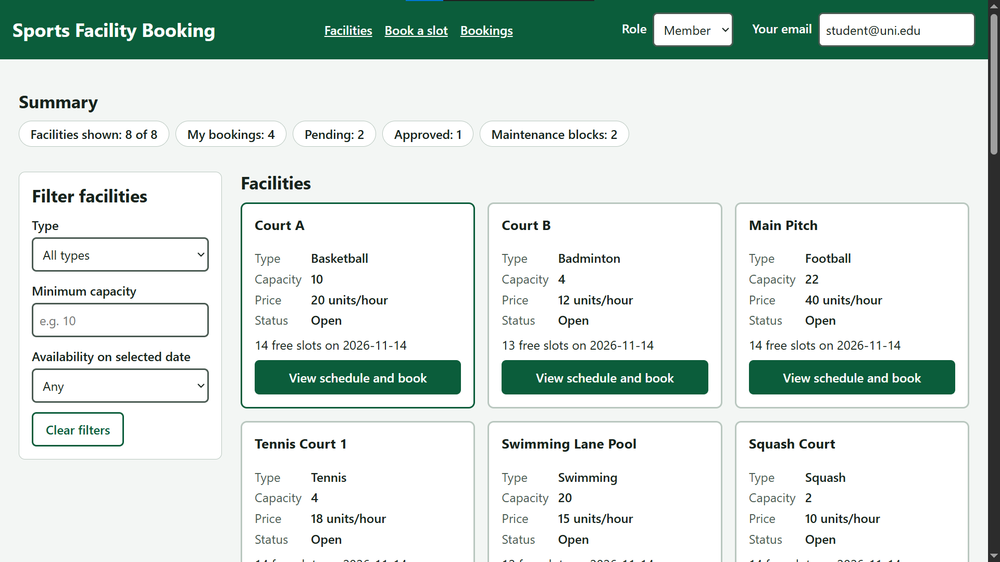

**Tablet (about 768 px wide): 2-column grid and real table**

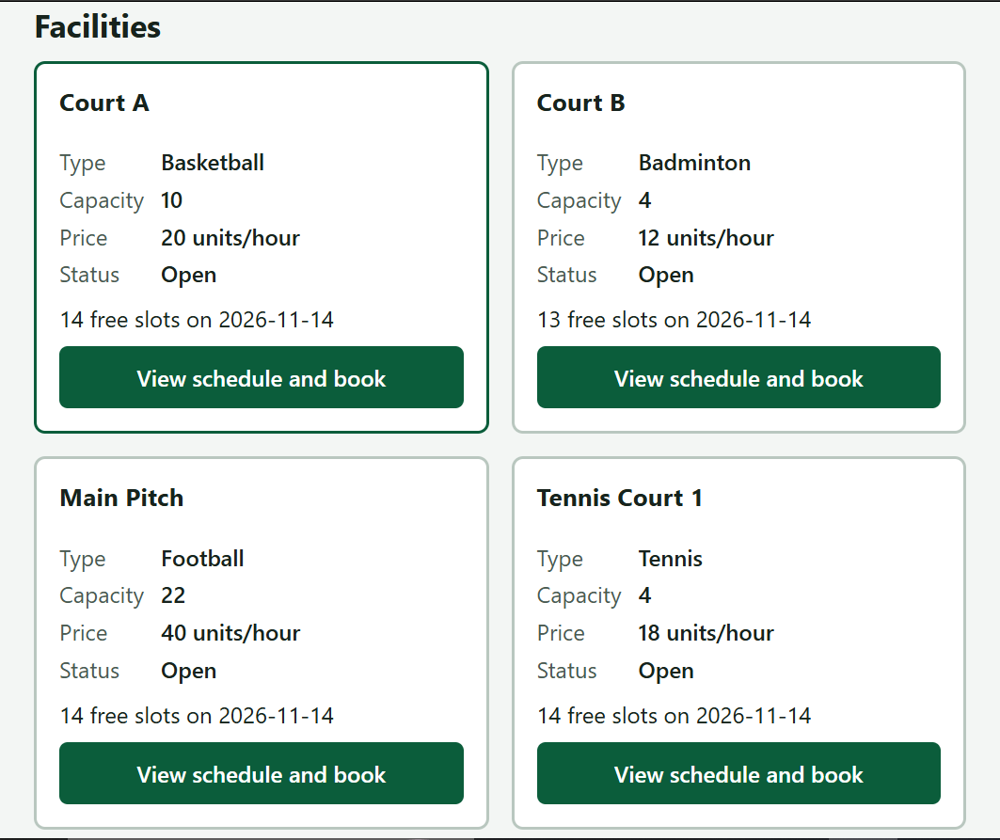

**Mobile (about 375 px wide): single column and stacked booking cards**

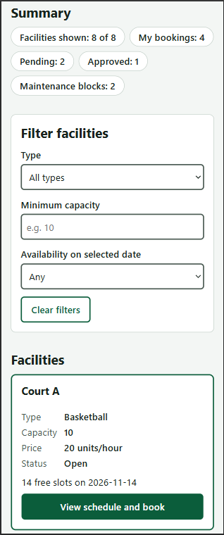

### 2.2 Main features

**Facility list with filters**

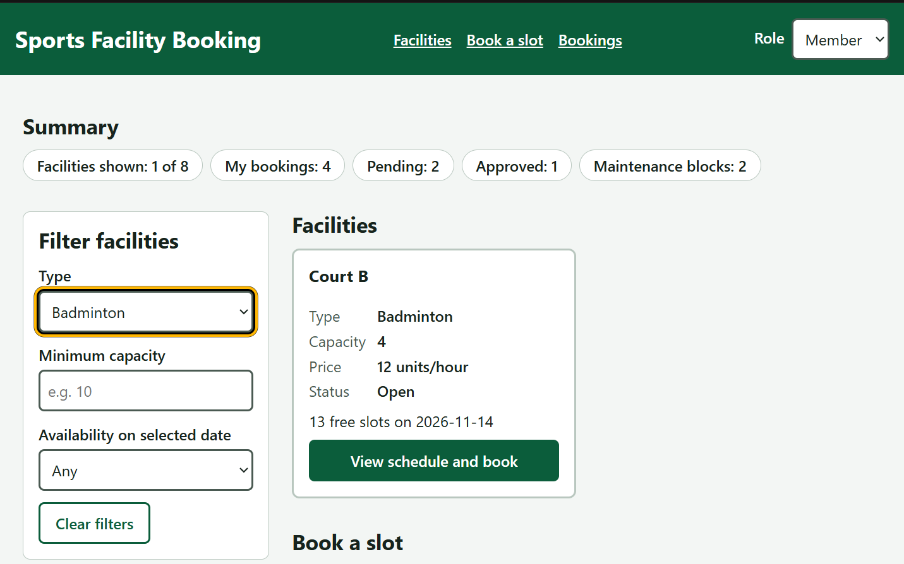

**Booking form with live cost calculation**

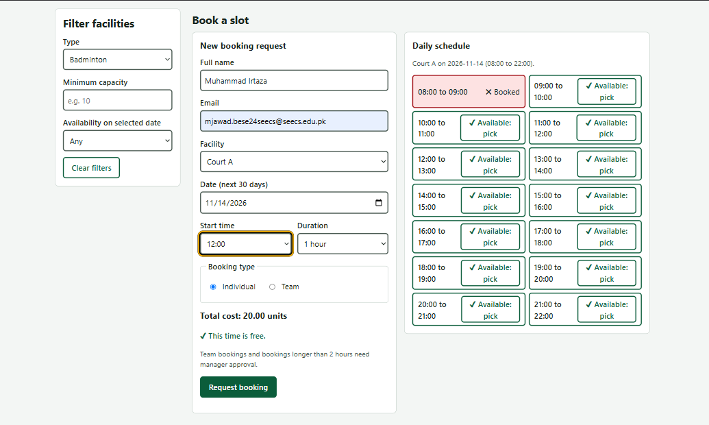

**Daily schedule (Available / Pending / Booked / Maintenance)**

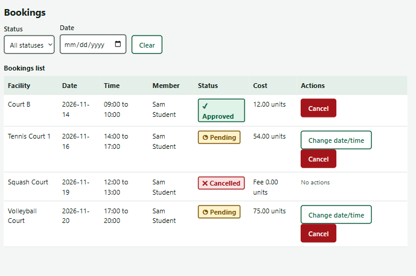

**Validation errors (invalid input)**

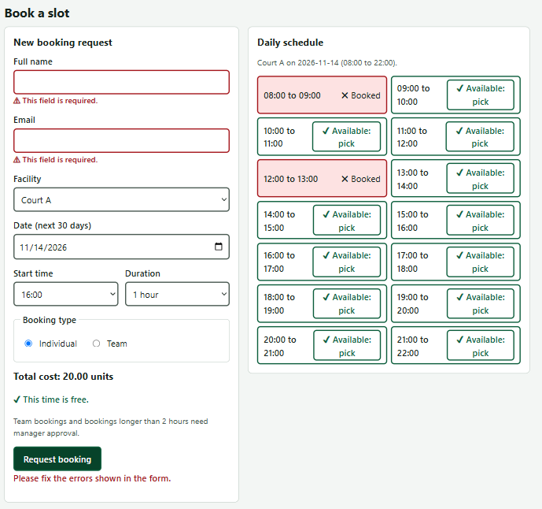

**Conflict detected with next-slot suggestion**

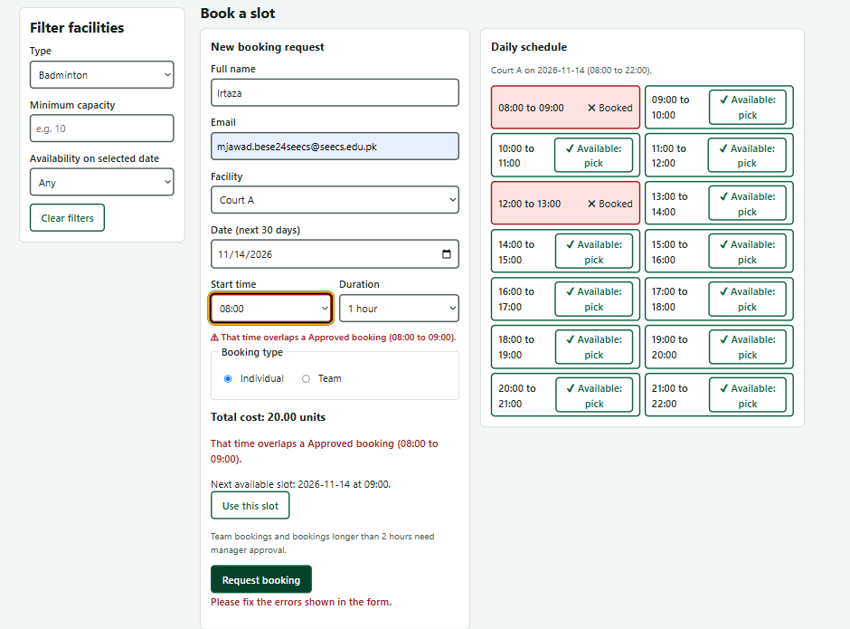

**Team booking fields**

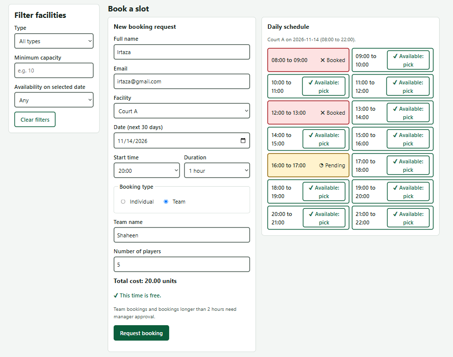

### 2.3 Manager features

**Manager view: approve / reject bookings**

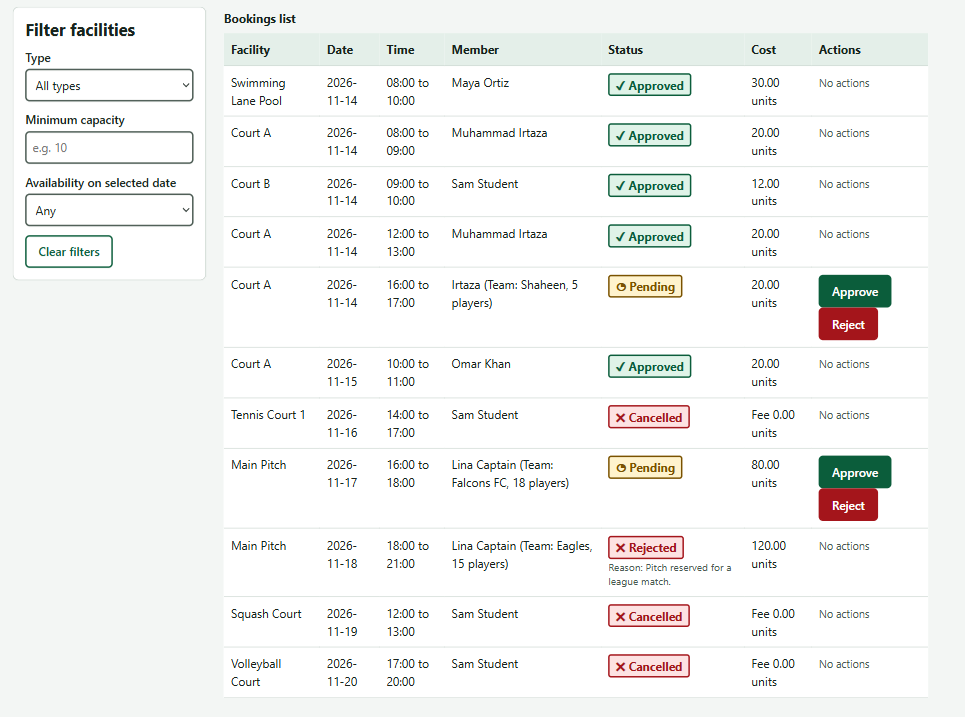

**Reject with reason panel**

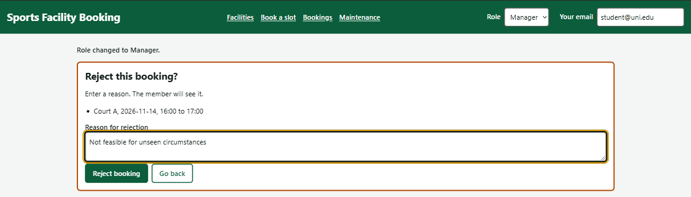

**Maintenance block form and list**

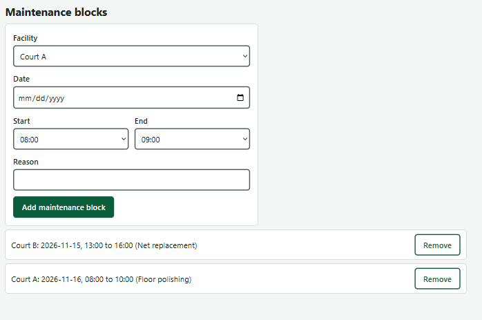

**Maintenance overlap warning**

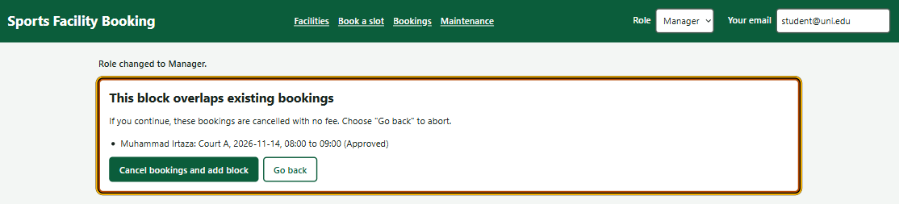

### 2.4 Cancellation and empty states

**Empty state**

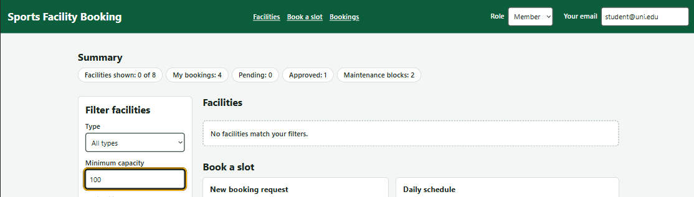

---

## 3. Design Note

### 3.1 User and problem

See [Project Overview](#1-project-overview). The target user is a university student or club member who needs to find and book a facility quickly. The second user is the facility manager, who needs to control approvals and maintenance.

### 3.2 WDLC (Web Development Life Cycle) stages

| Stage | What was done in this project |
|---|---|
| **1. Planning** | Chose idea No. 29, defined the problem, users, scope and constraints (HTML/CSS/JS only, no backend). |
| **2. Analysis** | Wrote a Software Requirements Specification: roles, functional requirements (FR1 to FR18), data, rules and the rubric mapping. |
| **3. Design** | Drew wireframes for three screen sizes; chose a green and white colour scheme with high contrast; designed the data model (facility, booking, maintenance block); designed the booking status flow. |
| **4. Implementation** | Built `index.html` (structure), `styles.css` (layout and responsive design) and `app.js` (logic). Committed to GitHub in small steps. |
| **5. Testing** | Tested valid, invalid and empty inputs, conflict cases, role switching, and the three screen sizes (see [Testing](#10-testing)). |
| **6. Deployment** | Pushed to GitHub (and GitHub Pages, if used). |
| **7. Maintenance** | Future work: add a server, a database and real login (see [Limitations](#11-limitations-and-future-work)). |

### 3.3 What runs in the browser (client) versus a server

| Runs in the browser now (client) | Would run on a server in a later stage |
|---|---|
| Showing and styling the page (HTML and CSS) | Serving the pages and static files |
| Form validation (HTML attributes plus JavaScript) | **Repeating all validation** (never trust the client) |
| Filtering, cost calculation, live availability | Shared availability for all users |
| Conflict checking against arrays in memory | **Conflict checking inside a database transaction**, so two users cannot book the same slot at the same moment (API and database consistency) |
| Role switching by a dropdown (controls shown or hidden) | Real login and **role-based authorisation** on every API call |
| Data in JavaScript arrays and `localStorage` | A database with CRUD API endpoints (for example `GET/POST/PUT/DELETE /bookings`) |
| Simulated approval workflow | Notifications (email) and audit history |

**Important:** hiding manager buttons with CSS is only a convenience. A real system must check the role on the server, because anyone can change the page in their browser.

### 3.4 Booking status flow

```
Request → [rules and conflict check] → Approved (auto)         → Completed
                                     → Pending (team or > 2 h) → Approved → Completed
                                                               → Rejected
Any active booking → Cancelled (member, with fee rules, or manager via maintenance)
```

### 3.5 Data model

| Object | Fields |
|---|---|
| **Facility** | `id`, `name`, `type`, `capacity`, `pricePerHour`, `status` |
| **Booking** | `id`, `facilityId`, `memberName`, `email`, `date`, `start`, `duration`, `type`, `teamName`, `players`, `status`, `cost`, `fee`, `reason` |
| **Maintenance block** | `id`, `facilityId`, `date`, `start`, `end`, `reason` |

---

## 4. Features

**Facilities and schedule**
- 8 facility cards with name, type, capacity, hourly price and free slots for the selected date
- Filter by type, minimum capacity and availability
- Daily schedule (08:00 to 22:00) marking each hour as Available, Pending, Booked, Maintenance or Past
- Click a free slot to fill in the form

**Booking (CRUD)**
- **Create:** a booking form with name, email, facility, date, start, duration, type, and team name and players for team bookings
- **Read:** bookings table, filterable by status and date
- **Update:** edit your own pending booking (conflict check runs again)
- **Delete / cancel:** cancel with the policy applied

**Rules and conflict handling**
- No overlap with Pending or Approved bookings for the same facility
- No overlap with maintenance blocks
- No past dates, no times outside opening hours, maximum 3 hours, booking window of 30 days
- The next available slot is suggested, with a button to use it
- Cancellation policy: free more than 24 hours before the start, 50% fee within 24 hours, and no cancellation after the start
- Team bookings and bookings longer than 2 hours need manager approval

**Manager tools**
- Approve or reject pending bookings (rejection needs a reason)
- Add and remove maintenance blocks, with a warning that lists affected bookings before they are cancelled

**Interactions (assignment asks for at least two)**
1. Filtering of facilities and bookings
2. Live cost and cancellation-fee calculation
3. Availability and conflict checking with suggestions
4. Dynamic summary counts, schedule and tables that update without a page reload

**Edge cases handled:** empty fields, invalid email, invalid name pattern, out-of-range numbers, past dates, double bookings, no filter results, no bookings, and HTML injection (user text is escaped before it is displayed).

**Accessibility:** one `h1` with logical headings, skip link, labels on every field, `fieldset` and `legend` for the booking type, visible focus outline, `aria-live` regions for messages and errors, status shown with text and symbols (not only colour), and 44 px minimum touch targets.

---

## 5. How to Run

No installation or server is needed.

1. Download or clone the repository:
   ```bash
   git clone <PASTE REPO URL>
   ```
2. Open the folder and double-click **`index.html`** (or right-click → *Open with* → your browser).
3. Use the **Role** dropdown in the header to switch between *Member* and *Manager*.

To see the original sample data again, click **Reset sample data** at the bottom of the page.

**Browser support:** current versions of Chrome, Edge, Firefox and Safari.

---

## 6. Project Structure

```
sports-facility-booking/
├── index.html        # Page structure: semantic HTML, forms, sections
├── styles.css        # Layout, variables, responsive design (Flexbox, Grid, media queries)
├── app.js            # All logic: data, rules, rendering, events
├── README.md         # This file (documentation and design note)
└── screenshots/      # Screenshots and wireframes used in this README
```

---

## 7. Sample Data

Sample data is created in `app.js` (function `buildSampleData`). Booking dates are relative to today, so they are never in the past.

**Facilities (8)**

| Name | Type | Capacity | Price per hour |
|---|---|---|---|
| Court A | Basketball | 10 | 20 |
| Court B | Badminton | 4 | 12 |
| Main Pitch | Football | 22 | 40 |
| Tennis Court 1 | Tennis | 4 | 18 |
| Swimming Lane Pool | Swimming | 20 | 15 |
| Squash Court | Squash | 2 | 10 |
| Table Tennis Hall | Table Tennis | 4 | 8 |
| Volleyball Court | Volleyball | 12 | 25 |

**Bookings (8)** include a mix of statuses: Approved, Pending, Rejected and Cancelled, plus two team bookings (Falcons FC and Eagles).

**Maintenance blocks (2):** Court B (net replacement) and Court A (floor polishing).

---

## 7.1 Quick Demo Guide

Use these steps to try every feature quickly:

1. **Member view:** use the default email `student@uni.edu` to see "your" bookings and the Edit/Cancel buttons.
2. **Book a slot:** click *Book a slot* on a card, fill in the form and watch the live cost change.
3. **Trigger a conflict:** pick a time that clashes with an existing booking or a maintenance block, and read the message and suggested slot.
4. **Validation:** submit the form with empty or invalid values.
5. **Team booking:** choose *Team* and submit, and the booking becomes *Pending*.
6. **Cancel:** cancel one of your bookings and read the fee message.
7. **Manager view:** switch Role to *Manager*. Approve or reject a pending booking, then add a maintenance block that overlaps a booking.

---

## 8. How the Code Works

### `index.html`
Defines the page using `header`, `nav`, `main`, `section`, `aside`, `form`, `table` and `footer`. Each input has a label and a matching error element. Sections that only a manager should see have the class `manager-only`.

### `styles.css`
- **Variables** on `:root` for colours, radius and spacing.
- **Box model:** `box-sizing: border-box` on all elements.
- **Mobile-first**, with two breakpoints:
  - `min-width: 600px` (tablet): 2-column card grid, table instead of stacked cards
  - `min-width: 1024px` (desktop): sidebar filters (Grid), 3-column card grid, form beside schedule
- **Flexbox** for the header, button rows and slots; **Grid** for cards, layout and the form rows.
- Role-based visibility using `body[data-role="..."]` selectors.

### `app.js`
The file is organised into numbered sections:

| Section | Purpose |
|---|---|
| 1. Constants and state | Opening hours, limits, and the arrays `facilities`, `bookings`, `blocks` |
| 2. Helpers | Date and time functions, `escapeHtml`, messages |
| 3. Data | `buildSampleData`, `saveData`, `loadData` (localStorage), `markCompletedBookings` |
| 4. Rules | `findConflict`, `getSlotStatus`, `findNextSlot`, `calcCancellation` |
| 5. Rendering | Draws the summary, facility cards, schedule, bookings table and block list |
| 6. Booking form | Validation, live checks, submit handling, edit mode |
| 7. Actions | Approve, reject, cancel, with a confirmation panel |
| 8. Maintenance | Maintenance form and overlap warning |
| 9. Start-up | `init()` loads data and attaches all event listeners |

**JavaScript concepts used:** variables (`const`, `let`), functions, arrays and array methods (`filter`, `find`, `map`, `some`), conditionals and loops, DOM selection and updates, events (`submit`, `click`, `input`, `change`), event delegation, `localStorage`, `try/catch`.

---

## 9. Requirements Coverage

| Assignment requirement | Where it is met |
|---|---|
| Only semantic HTML, CSS and vanilla JS | No frameworks, templates or libraries anywhere in the repo |
| Defined user and core workflow | [Section 1](#1-project-overview) |
| Accessible headings, labels, input types, form with browser validation | `index.html`: `required`, `type="email"`, `type="date"`, `type="number"`, `min`, `max`, `pattern` |
| Selectors, box model, Flexbox or Grid | `styles.css` |
| At least two media-query breakpoints; mobile, tablet, desktop layouts | 600 px and 1024 px breakpoints ([Screenshots 2.1](#21-responsive-layouts-mobile-tablet-desktop)) |
| Variables, functions, arrays, conditionals, DOM events | `app.js` |
| At least two meaningful interactions | Filtering, calculation, conflict checking, dynamic results |
| Handle empty and invalid input | Validation messages and empty states |
| At least six student-created sample records | 8 facilities, 8 bookings, 2 maintenance blocks |
| Wireframe and design note (user/problem, WDLC, client vs server) | [Section 3](#3-design-note) |
| Works without a backend | Runs by opening `index.html` |

**Group-level extension (idea No. 29):** facility calendars, team bookings, maintenance blocks, approval and cancellation policy are all implemented.
**Course concepts demonstrated:** scheduling constraints, CRUD, role access (simulated), conflict handling, and API/database consistency (explained in [3.4](#34-what-runs-in-the-browser-client-versus-a-server)).

---

## 10. Testing

Manual tests carried out. Fill in the **Result** column after testing (✅ pass / ❌ fail).

| # | Test | Expected result | Result |
|---|---|---|---|
| 1 | Submit the booking form with all fields empty | Error messages appear next to the required fields; no booking is created | ☐ |
| 2 | Enter an invalid email (for example `abc`) | Email error shown | ☐ |
| 3 | Enter a name with numbers or symbols | Name pattern error shown | ☐ |
| 4 | Choose a date in the past | Rejected with a clear message (the date picker also blocks it) | ☐ |
| 5 | Choose a date more than 30 days ahead | Rejected | ☐ |
| 6 | Book a time that overlaps an Approved or Pending booking | Conflict message and a suggested next slot | ☐ |
| 7 | Book a time that overlaps a maintenance block | Conflict message naming the block | ☐ |
| 8 | Book a 1-hour individual slot that is free | Booking is Approved automatically | ☐ |
| 9 | Book a team booking | Booking is Pending (needs manager approval) | ☐ |
| 10 | Book a 3-hour individual booking | Booking is Pending | ☐ |
| 11 | Team booking without a team name or player count | Errors shown | ☐ |
| 12 | Change duration and facility | Total cost updates immediately | ☐ |
| 13 | Edit your own Pending booking to a conflicting time | Rejected with a conflict message | ☐ |
| 14 | Cancel a booking more than 24 hours ahead | Free cancellation message | ☐ |
| 15 | Cancel a booking within 24 hours of the start | 50% fee shown before confirming | ☐ |
| 16 | Filter facilities with a capacity that nothing matches | "No facilities match your filters." | ☐ |
| 17 | Filter bookings by a status or date with no results | Empty message shown | ☐ |
| 18 | Switch role to Manager | Approve/Reject buttons and Maintenance section appear | ☐ |
| 19 | Reject a booking with no reason | "Please enter a reason." error | ☐ |
| 20 | Add a maintenance block that ends before it starts | Error shown | ☐ |
| 21 | Add a maintenance block overlapping a booking | Warning panel lists affected bookings; "Go back" aborts | ☐ |
| 22 | Reload the page | Data is kept (localStorage) | ☐ |
| 23 | Click *Reset sample data* | Original sample data returns | ☐ |
| 24 | Type `<b>test</b>` into a text field | Text is shown as plain text, not as HTML | ☐ |
| 25 | Resize to 375 px, 768 px and 1280 px | Layout adapts with no sideways page scrolling | ☐ |
| 26 | Use only the keyboard (Tab, Enter, Space) | All controls reachable; focus visible | ☐ |

---

## 11. Limitations and Future Work

**Limitations (current stage)**
- No backend: data is stored only in your own browser and is not shared between users.
- Roles and emails are simulated, so anyone can choose the Manager role.
- Conflict checking happens in the browser only.
- No notifications, payments or recurring bookings.

**Future work**
- Node.js (or similar) server with a REST API and a database
- Real authentication and server-side role authorisation
- Server-side validation and transaction-safe conflict checks
- Email notifications and a manager calendar view
- Recurring bookings and waiting lists

---

## 12. Attribution

| Item | Source / How it was used |
|---|---|
| Code | Written for this assignment using only HTML, CSS and vanilla JavaScript. No frameworks, templates or copied site code. |
| AI assistance | `"Claude (Anthropic) was used to help write the requirements specification and to draft the initial code. I reviewed, tested and modified the code, and I can explain how it works.">` |
| Fonts | System font stack (`system-ui`, Segoe UI, Roboto). No external fonts. |
| Icons / images | None used. Status symbols are text characters. |

---

